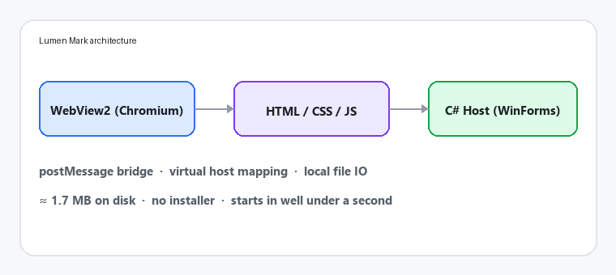

# Lumen Mark 使用说明

Lumen Mark 是一个**轻量、本地优先**的 Markdown 阅读与编辑器：没有账号、没有云同步、没有订阅，双击 exe 就能用。整个程序约 1.7 MB，界面由 WebView2 渲染，文件读写由 C# 宿主完成。

> 设计目标：打开就是阅读，需要时立刻能写。写作时左侧是 Markdown 源码，右侧是实时排版预览。

## 快速开始

1. 按 `Ctrl+O` 打开一个 `.md` 文件，或直接把文件拖进窗口；
2. 用顶部 **阅读 / 分屏 / 源码** 三个按钮切换视图；
3. `Ctrl+S` 保存，`Ctrl+Shift+S` 另存为；
4. 右侧栏的「目录」会跟随文档的标题自动生成，滚动时高亮当前章节。

支持的文件编码：UTF-8（含 BOM）、UTF-16，以及 GBK 编码的旧文件会自动识别。

## 快捷键

| 快捷键 | 功能 |
| --- | --- |
| `Ctrl+O` | 打开文件 |
| `Ctrl+S` | 保存 |
| `Ctrl+Shift+S` | 另存为 |
| `Ctrl+E` | 切换阅读 / 分屏 / 源码 |
| `Ctrl+Shift+L` | 显示或隐藏侧边栏 |
| `Ctrl+Shift+T` | 切换主题（浅色 / 深色 / 跟随系统） |
| `Ctrl+B` / `Ctrl+I` | 加粗 / 斜体 |
| `Ctrl+K` | 插入链接 |

## 代码高亮

```javascript
// 预览层只用两个小依赖：markdown-it + highlight.js
const md = markdownit({ html: true, linkify: true });

function render(text, dir) {
  return md.render(text, { dir }); // dir 用于解析相对路径图片
}
```

```python
def reading_time(text: str) -> int:
    cjk = sum(1 for ch in text if "\u4e00" <= ch <= "\u9fff")
    words = len([w for w in text.split() if w.strip()])
    return max(1, round(cjk / 380 + words / 220))
```

## 任务清单

- [x] 本地文件读写（含编码识别）
- [x] 实时预览与目录大纲
- [x] 相对路径图片解析
- [ ] 多标签页（下一步）
- [ ] 全文搜索（下一步）

## 架构示意



程序分为三层：**C# 宿主**负责窗口、文件与对话框；**WebView2** 提供 Chromium 渲染；**前端**只做排版和交互，两者通过 `postMessage` 传递 JSON 消息。

## 引用与分隔线

> 好工具的标准：打开快、不打扰、数据留在自己手里。
>
> —— 这也是 Lumen Mark 的全部野心。

---

### 小结

如果你每天都要读很多 Markdown，又不想为"看个文件"而启动一个 IDE，Lumen Mark 就是为这个场景做的。文件永远在你自己的磁盘上，程序也永远不联网。
